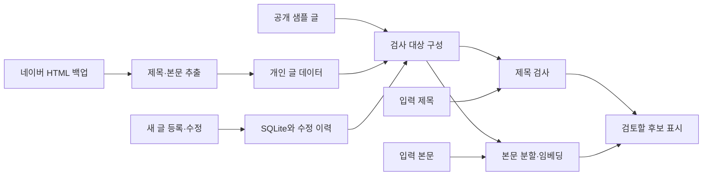

# Blog Similarity Checker — 블로그 글 유사도 검사

Python · Streamlit · Sentence Transformers · SQLite

**과거에 쓴 글을 기억하기 어려운 블로그 운영자를 위한 개인용 AI 검색 도구입니다.** 새 글의 제목과 본문을 기존 글과 비교하고, 검토할 만한 문단을 나란히 보여줍니다. 네이버 백업 가져오기부터 새 글 등록·수정, 검은 창 없는 실행과 종료까지 하나의 사용 흐름으로 연결했습니다.

공개된 다국어 문장 임베딩 모델을 활용한 응용 프로젝트입니다. 모델을 직접 학습하지 않았으며, 표절 여부나 중복 확률을 판정하는 서비스는 아닙니다.

## Windows 자동 설치판

**[Windows 설치 파일 바로 다운로드](https://github.com/Jino-222/blog-similarity-checker/releases/latest/download/BlogSimilarityChecker-Setup.exe)** · [버전·검증값 확인](https://github.com/Jino-222/blog-similarity-checker/releases/latest)

`BlogSimilarityChecker-Setup.exe` 실행 → **설치 시작** → **검사기 실행**

Python과 AI 모델을 자동으로 준비하고 바탕화면 아이콘을 만듭니다. 첫 설치에는 인터넷이 필요하며, 샘플 글 3개로 시작합니다. Windows 10/11 Intel·AMD 64비트용입니다. [설치·업데이트·제거 안내](docs/windows-installer.md)

## 처음 방문했다면

- **사용 흐름 보기:** [사용 방법](docs/usage.md)을 확인하세요.
- **간편 실행:** 위 자동 설치판을 내려받으세요. Python 설치나 명령어 입력 없이 준비할 수 있습니다.
- **코드 살펴보기:** `app.py` → `body_check.py` → `post_manager.py` 순서로 읽으면 검사와 저장 흐름을 볼 수 있습니다.
- **문제 해결 과정:** [개발 기록](docs/development.md)에서 AI 제목 검색 누락을 발견하고 보완한 과정을 확인하세요.
- **검증과 기여 구분:** [검증 기록](docs/validation.md), [AI 활용과 역할](docs/contributions.md)을 확인하세요.

공개 패키지는 가상 샘플 글 3개로 시작합니다. 실제 블로그 데이터와 개인 개발 화면 캡처는 포함하지 않습니다.

## 왜 만들었나요?

블로그 글이 쌓이면 새로운 주제라고 생각했던 내용을 이미 작성했거나, 표현만 바꿔 비슷한 설명을 반복할 수 있습니다. 기존 글을 하나씩 찾아 읽는 대신, 작성 과정에서 관련 글과 겹치는 문단을 빠르게 확인하는 도구를 만들고자 했습니다.

처음에는 샘플 제목과 글자 유사도부터 시작했습니다. 이후 의미 비교, 실제 백업 연결, 본문 비교, 글 관리, 사용자 화면 순서로 확장했습니다. 새로운 기능은 실행 화면과 제한된 테스트 사례를 확인하며 단계적으로 추가했습니다.

## 주요 기능

| 기능 | 사용자가 하는 일 | 프로그램의 동작 |
|---|---|---|
| 제목 검사 | 제목과 선택적 핵심 단어 입력 | 완전 일치·표기 차이·의미 유사·글자 유사 후보 표시 |
| 핵심 단어 우선 | 반드시 찾고 싶은 단어 지정 | 해당 단어가 포함된 제목을 AI 점수와 관계없이 먼저 표시 |
| 본문 검사 | 초안 붙여 넣기 | 긴 문단을 나눠 비교하고 입력 구간과 기존 문단을 나란히 표시 |
| 백업 가져오기 | 압축 해제한 네이버 백업 폴더 지정 | HTML에서 제목·본문 추출, 실패 목록과 미리보기 저장 |
| 글 등록·수정 | 게시글 주소·제목·본문 저장 | 글 번호를 기준으로 추가 또는 갱신하고 수정 전 내용 보관 |
| 간편 실행 | 실행 파일 또는 바로가기 열기 | CMD 없이 브라우저 열기, 중복 실행 방지, 종료 버튼 제공 |

## 개발자용: 소스 코드에서 설치와 실행

개발·확인 환경은 **Windows / Python 3.11.9**입니다. Python launcher(`py`)가 설치되어 있어야 합니다. 이 저장소를 내려받아 압축을 풀고, `app.py`가 있는 폴더에서 명령 프롬프트를 엽니다.

```bat
py -3.11 -m venv .venv
.venv\Scripts\python.exe -m pip install -r requirements.txt
```

설치 후 **`start_app.vbs`를 더블클릭**합니다. 이 절은 소스 코드 직접 실행 방법입니다. 일반 사용자는 위 자동 설치판을 사용하세요.

- 첫 AI 검사에서는 모델을 다운로드하므로 인터넷과 저장 공간이 필요합니다.
- 비교 연산은 로컬에서 수행합니다. 유료 AI API 키는 사용하지 않습니다.
- 실행 후 브라우저에 `http://127.0.0.1:18766` 화면이 열립니다.
- 실행 파일을 다시 열면 기존 실행 작업을 재사용합니다. 브라우저 탭은 추가로 열릴 수 있습니다.
- 사용을 끝낼 때는 **화면 아래 ‘프로그램 종료’**를 누릅니다. 브라우저 탭만 닫으면 프로그램은 계속 실행됩니다.
- VBS 실행이 제한된 환경에서는 `.venv\Scripts\pythonw.exe launcher.pyw`로 실행할 수 있습니다.
- 오류 확인용 `start.bat`는 CMD를 표시하는 별도 실행 방식입니다. 이 방식은 CMD에서 Ctrl+C로 종료합니다.

실행 관리에는 로컬 18765번, 검사 화면에는 18766번 포트를 사용합니다. 해당 주소를 다른 프로그램이 사용하면 실행을 중단합니다. 자세한 사용·문제 해결 방법은 [사용 안내](docs/usage.md)에 있습니다.

## 처음 사용할 때

1. **제목 검사:** `실내 식물 물 주는 방법`을 입력하고, ‘우선 찾을 단어’에 `실내 식물`을 지정합니다.
2. **본문 검사:** ‘기존 글 일부로 테스트하기’를 누른 뒤 ‘본문 검사하기’를 실행합니다.
3. **결과 검토:** 같은 문구를 찾는지 확인하고, 내용을 바꿔 점수와 검색 결과를 비교합니다.
4. **개인 자료 연결:** [사용 안내](docs/usage.md)의 백업 가져오기 절차를 따릅니다.
5. **게시 후 관리:** 새 글을 네이버에 게시한 다음 주소·제목·본문을 프로그램에 등록합니다. 주소만으로 본문을 자동 수집하지 않습니다.

## 코드 읽는 순서

| 파일·폴더 | 확인할 내용 |
|---|---|
| `app.py` | 데이터 로딩, 메뉴 연결, 제목 비교와 정렬 |
| `data_source.py` | 공개 샘플과 개인 데이터 분리 |
| `body_check.py` | 토큰 길이를 고려한 분할, 임베딩 캐시, 문단별 검색 |
| `post_manager.py` | 주소 정규화, SQLite 저장·갱신·수정 이력 |
| `import_backup.py` | 네이버 HTML 구조에서 제목·본문 추출 |
| `launcher.pyw`, `app_controls.py` | 단일 실행 관리, 준비 상태 확인, 종료 요청 |
| `design.py`, `.streamlit/`, `assets/` | 화면 디자인과 전용 아이콘 |
| `sample_data/` | 공개용 가상 예시 글 3개 |
| `tests/` | 원본 데이터 없는 자동 검사 |
| `docs/` | 사용법, 개발 과정, 검증과 기여 범위 |

## 처리 흐름



제목은 정규화된 글자 비교와 문장 임베딩의 코사인 유사도를 함께 사용합니다. 본문은 한 줄 단위 문단을 토큰 길이 기준으로 나누고 일부 구간을 겹쳐 비교합니다. 입력 구간별로 서로 다른 기존 글에서 최대 3개 후보를 표시합니다. 단순 일치 외에는 사람이 내용을 확인하도록 설계했습니다.

## 확인한 사례

| 확인 항목 | 관찰한 결과 | 해석 범위 |
|---|---|---|
| 개인 백업 가져오기 | 저장 271개, 읽기 실패 0개, 중복 제외 0개 | 해당 백업에 대한 실행 결과이며 모든 HTML 형식 지원을 뜻하지 않음 |
| 제목 의미 검색 누락 | 관련 글 0.568, 기본 기준 0.70에서 제외 | 모델 점수만으로 필요한 글을 놓칠 수 있음 |
| 핵심 단어 보완 | 지정 단어가 있는 글이 먼저 표시됨 | 검색 규칙 보완이며 모델 재학습은 아님 |
| 동일 문단 비교 | 원문을 1.000으로 검색 | 복사한 문단 사례 |
| 표현을 바꾼 문단 | 원문을 0.766으로 검색 | 한 문장 변형 사례, 전체 정확도 지표가 아님 |
| 기존 글 수정 | 저장 성공 후 271개 유지 | 실제 화면에서 중복 추가 없이 갱신 확인 |
| 실행 관리 | 중복 실행 시 동일 작업 재사용, 종료 후 작업·실행 정보 정리 | 로컬 실행 제어 테스트 |

정확도·재현율·F1, 처리 속도, 사용자 시간 절감률은 측정하지 않았습니다. 자세한 조건은 [검증 기록](docs/validation.md)을 참고하세요.

## 재현과 검사

설치한 프로젝트 폴더에서 실행합니다.

```bat
.venv\Scripts\python.exe -m unittest discover -s tests -v
```

이 자동 검사는 가상 데이터로 주소 처리·등록·수정·개인 데이터 선택·HTML 추출을 확인합니다. 모델 다운로드, 전체 앱 화면, 검색 품질, 별도 Windows 컴퓨터의 신규 설치까지 검증하지는 않습니다. 실제 실행 테스트와 자동 검사 범위를 구분해 기록했습니다.

## 해석할 때 확인할 점

- **점수는 중복 확률이 아닙니다.** 주제만 비슷하거나 상용 문구가 겹쳐도 높은 점수가 나올 수 있습니다.
- 제목 0.70, 본문 0.75는 임시 기준입니다. 별도 평가 데이터로 선정한 최적값이 아닙니다.
- 제목의 ‘우선 찾을 단어’는 지정 문자열 포함 여부로 동작합니다. 한국어 형태소 분석이나 자동 핵심어 추출 기능은 아닙니다.
- 본문 후보 수는 구간별 최대 3개입니다. 표시 결과를 모든 중복 사례의 목록으로 해석하면 안 됩니다.
- 이미지 속 글자는 읽지 않습니다. 표는 텍스트로 추출하므로 행·열 관계가 약해질 수 있습니다.
- 전체 본문 자료가 바뀌면 캐시를 다시 준비합니다. 큰 데이터에서 추가적인 성능 개선이 필요합니다.
- 개인용 로컬 도구입니다. 공개 서비스용 로그인·권한·다중 사용자 지원은 없습니다.

## 파일 구성과 공개 범위

공개 파일에는 실행 코드, 아이콘, 설정 예시, 가상 샘플, 문서와 자동 검사가 포함됩니다. 실제 블로그 본문·HTML 백업·DB·수정 이력·캐시·가상환경·개인 경로 설정은 포함하지 않습니다. `local_settings.json`이 없으면 샘플로 실행됩니다.

`.gitignore`는 이미 Git에서 추적하는 파일을 자동으로 제거하지 않습니다. 게시 전 변경 파일 목록을 확인하세요. 공개 범위와 출처는 [공개 자료 안내](docs/distribution.md)에 정리했습니다.

## 개발 방식과 다음 개선

실제 블로그 운영에서 필요한 기능을 정하고, AI 개발 도구의 도움을 받아 구현·수정하며 화면에서 동작을 확인했습니다. 요구사항과 사용자 확인, AI 도구가 작성한 코드 및 자동 검증의 범위는 [기여 기록](docs/contributions.md)에 구분했습니다.

다음 개선 대상으로 한국어 검색 평가 사례 확대, 공통 도입 문구 처리, 바뀐 문단만 갱신하는 캐시, 더 편리한 설치 패키지를 고려하고 있습니다. 현재 구현된 기능과 향후 계획을 구분해 관리합니다.

사용 모델: [Sentence Transformers 다국어 MiniLM 모델](https://huggingface.co/sentence-transformers/paraphrase-multilingual-MiniLM-L12-v2) · [Streamlit](https://docs.streamlit.io/) · [Sentence Transformers](https://sbert.net/)
